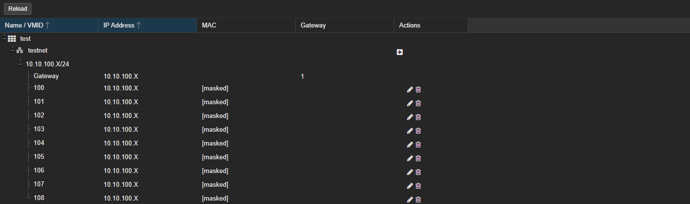
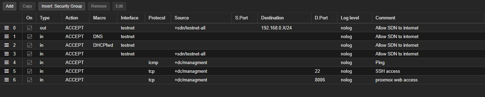
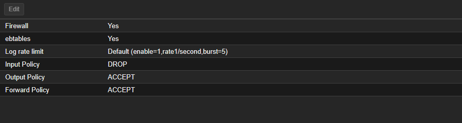
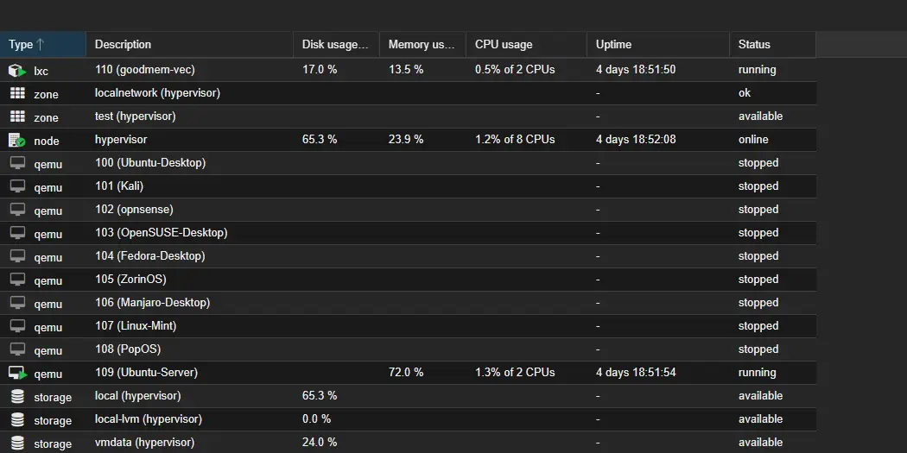
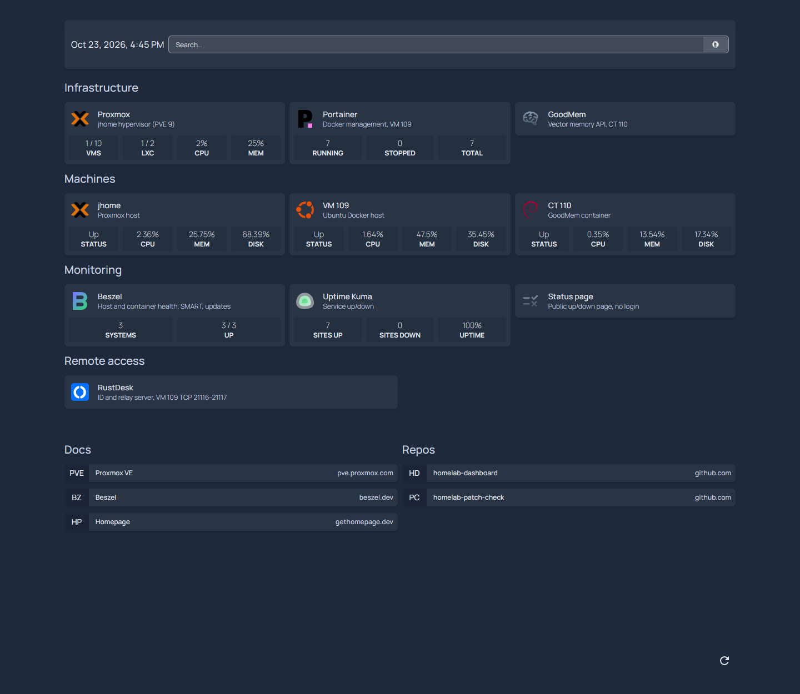

# JHomelab

My homelab runs Proxmox VE on an old Alienware 15 R3 laptop. It's where I practice the things I don't get to touch at work or in class: running a real hypervisor, splitting a lab network off with SDN, writing firewall rules, and keeping Linux services patched and monitored. This repo is my running journal for it. It covers the hardware, the network layout, every guest, what's deployed, what's next, and a changelog of what I actually did and when.

## What's in this repo

Mostly documentation for now. This README is the current state of the lab. From November 2026 on, each project gets its own folder.

| Folder | What's in it |
| :--- | :--- |
| `projects/` | One folder per project, named by month, with a write-up of what I did, what I measured and what I didn't check |
| `docs/` | Reference pages that describe the lab as it is now. [`docs/topology.md`](docs/topology.md) has the network diagram |
| `notes/` | Point-in-time checks that aren't projects, like the September health check |
| `screenshots/` | Captures from the Proxmox web UI and my dashboard |

Sanitized configs (SDN exports, firewall rules, compose files, scripts) will go in their own folders once they stop changing every week.

Local IPs keep the first three octets and swap the last one for `X`.

Last updated **November 11, 2026**.

| Project | Date | Result | Write-up |
| :--- | :--- | :--- | :--- |
| DIR-885L wireless bridge | November 10–11, 2026 | Replaced the Wi-Fi extender between the lab and the home router with an OpenWrt bridge. Lab-to-home throughput went from about 47 to 239–369 Mbit/s. It passed a 19-hour soak test with every monitor at 100%. Three Wi-Fi drops of 5 to 7 seconds, caused by the router's band steering, are still open | [projects/2026-11-dir885l-wireless-bridge](projects/2026-11-dir885l-wireless-bridge/README.md) |
| Patching and monitoring | October 21–23, 2026 | Patched every host after a CA compromise, set up Beszel and Uptime Kuma with Discord alerts, and rebuilt the dashboard | [projects/2026-10-patching-and-monitoring](projects/2026-10-patching-and-monitoring/README.md) |

- [September 22 health check](notes/health-check-2026-09-22.md): a read-only look at the host and guests that I use as a baseline.

The coursework that fed into this build:

- [SVAD-111-Linux-Virtualization](https://github.com/jkosber/SVAD-111-Linux-Virtualization): Linux admin and virtualization
- [Networking-109](https://github.com/jkosber/Networking-109): CCNA Networking I (Cisco IOS, addressing, routing)
- [CyberOps-115](https://github.com/jkosber/CyberOps-115): Cisco CyberOps Associate (Security Onion, Snort, packet analysis)

## What I get out of running it

- Time on a real Proxmox install (PVE 9.2.26, kernel 7.0.14-28-pve) instead of reading about one.
- SDN with its own VNet, IPAM and DHCP, plus addresses I can predict from the VMID.
- A pile of Linux families to break (Debian/Ubuntu, Fedora, Arch, SUSE, Pop!_OS, Mint, Zorin) without touching my daily machine.
- PCI passthrough. The GTX 1070 Mobile is bound to `vfio-pci` so VMs can use it.
- Docker services on VM 109, managed in Portainer and updated automatically.
- Monitoring that pings me in Discord. Beszel watches the machines and drives, and Uptime Kuma watches the services.
- Real patch work. In October 2026 a certificate authority was compromised and I had to track the fixes across every host.
- Notes good enough to rebuild the whole thing if the host ever gets wiped.

## Network layout

- **Core router:** TP-Link Archer AX90, a tri-band Wi-Fi 6 router in the AX6600 class. Routing, DHCP and the edge firewall. One SSID covers all three bands.
- **Distribution:** a D-Link DIR-885L running OpenWrt, working as a Wi-Fi client bridge (`relayd`) into the lab over the router's 5 GHz radio. It replaced a Netgear WN2000RPTv2 range extender on November 11, 2026; I retired the extender that evening, after the bridge passed its soak test. A Cat6 run will replace the wireless hop for gigabit.
- **Access:** still flat. The Proxmox host plugs straight into the bridge's LAN port 1, and the other three ports are empty. I unplugged the old 24-port lab switch on November 11 because the lab has too few wired devices to need it. A managed switch is on the list so I can tag 802.1Q VLANs for home, lab and management.

The [topology page](docs/topology.md) has the diagram, the addressing and what the bridge does and doesn't pass. The [project write-up](projects/2026-11-dir885l-wireless-bridge/README.md) covers how I set it up.

## Physical host: `jhome`

| Component | Specification | Role / Pool |
| :--- | :--- | :--- |
| Platform | Alienware 15 R3 | Hypervisor host |
| Hypervisor | Proxmox VE 9.2.26 / kernel 7.0.14-28-pve | Bare metal |
| Management IP | `192.168.0.X` | Web UI on port 8006 |
| CPU | Intel i7-7700HQ (4C / 8T) | Core compute |
| RAM | 16 GB DDR4 | Over-provisioned across the lab guests |
| GPU (host) | Intel HD Graphics 630 | Console / host display |
| GPU (passthrough) | NVIDIA GTX 1070 Mobile | Bound to `vfio-pci`, assigned to VMs 100, 105, 107 and 108 |
| SSD | SK Hynix 128 GB | Proxmox install, `local` and `local-lvm`. It's aging, so Beszel watches its SMART data |
| HDD | HGST 1 TB | `vmdata`, where the guest disks live today. It becomes the backup drive once the NVMe is in use |
| NVMe | Leftover SSD from Windows | Hidden by the BIOS's Intel RST RAID mode. Planned home for the guest disks |

## SDN and IPAM

The lab network is Proxmox's built-in SDN. Anything I'm experimenting with (broken Linux installs, Kali scans, OPNsense builds) goes on `testnet` so it stays off the home LAN. VMs 100–108 and the CT 111 pilot are on it. VM 109 and CT 110 are still on `vmbr0`, and moving them over is planned.

| Network | Zone | Bridge / VNet | Subnet | IPAM | Gateway |
| :--- | :--- | :--- | :--- | :--- | :--- |
| Home LAN | none | `vmbr0` | `192.168.0.X/24` | Static / router DHCP | `192.168.0.X` |
| Lab SDN | `test` | `testnet` | `10.10.100.X/24` | PVE IPAM (DHCP) | `10.10.100.X` |

**Addressing rule.** Each lab VM's address ends in its VMID, so I can match the Proxmox inventory against packet captures and firewall logs without looking anything up. VMs 100–108 follow it. CT 111 is the one exception right now.

*IPAM mappings for the lab gateway and VMs 100–108, September 22. IPs and MAC addresses are masked.*

### Firewall (datacenter level)

Input defaults to **DROP**, so anything coming in needs an accept rule. Output and forwarding default to **ACCEPT**. Seven allow rules cover lab network access, DNS and DHCP, and management access: ping, SSH on 22 and the web UI on 8006.

*Datacenter > Firewall with the seven allow rules. Per-VNet and per-VM firewalls are the next layer.*

*Firewall on, input dropping by default.*

The [September health check](notes/health-check-2026-09-22.md#sdn-and-firewall) lists three things I want to sort out before the SDN grows: a mislabeled rule, pending changes in the legacy firewall view, and a forwarding setting that doesn't match the bridges.

## Virtual machines

The VMs have about 47 GB of RAM assigned, plus 4 GB for the GoodMem container and 512 MB for the Caddy pilot, on a host with 16 GB. That's on purpose. Only VM 109 and CT 110 boot with the host, and everything else stays off until I'm working on it.

*September 22: VM 109 and CT 110 running, VMs 100–108 stopped.*

### Always-on

| ID | Name | IP | OS | RAM | Disk | State | Role |
| :--- | :--- | :--- | :--- | :--- | :--- | :--- | :--- |
| VM 109 | `Ubuntu-Server` | `192.168.0.X` | Ubuntu Server 26.04.1 LTS | 2 GB | 32 GB | Running | Docker host for the core services |
| CT 110 | `goodmem-vec` | `192.168.0.X` | Debian 13.7 | 4 GB | 24 GB | Running | GoodMem / PostgreSQL |

### Lab guests (`testnet`)

All of these were stopped at the last update.

| ID | Name | IP | OS | RAM | Disk | Notes |
| :--- | :--- | :--- | :--- | :--- | :--- | :--- |
| 100 | `Ubuntu-Desktop` | `10.10.100.X` | Ubuntu Desktop | 8 GB | 200 GB | Desktop workstation and my current Tailscale node |
| 101 | `Kali` | `10.10.100.X` | Kali Linux | 2 GB | 30 GB | |
| 102 | `opnsense` | `10.10.100.X` | FreeBSD / OPNsense | 3 GB | 16 GB | Single-NIC lab gateway, still in progress |
| 103 | `OpenSUSE-Desktop` | `10.10.100.X` | openSUSE | 4 GB | 30 GB | |
| 104 | `Fedora-Desktop` | `10.10.100.X` | Fedora | 4 GB | 30 GB | |
| 105 | `ZorinOS` | `10.10.100.X` | Zorin OS | 8 GB | 40 GB | |
| 106 | `Manjaro-Desktop` | `10.10.100.X` | Manjaro (Arch) | 4 GB | 30 GB | |
| 107 | `Linux-Mint` | `10.10.100.X` | Linux Mint | 4 GB | 30 GB | |
| 108 | `PopOS` | `10.10.100.X` | Pop!_OS | 8 GB | 30 GB | |
| CT 111 | `caddy-pilot` | `10.10.100.X` | Debian 13.6 | 512 MB | 4 GB | Caddy reverse-proxy pilot with internal HTTPS |

## Services on VM 109

Docker Engine 29.1.3, set up as a Portainer stack. Watchtower pulls new images for most of it once a day.

| Service | Port | State | What it does |
| :--- | :--- | :--- | :--- |
| Homepage 2.7.0 | 3000 | Running | My dashboard, with live Proxmox, Portainer, Beszel and Uptime Kuma panels |
| Uptime Kuma 2.5.9 | 3001 | Running | Service checks, a status page on the LAN, Discord alerts |
| Beszel 0.21.1 | 8090 | Running | Host and container health, drive SMART, pending updates, Discord alerts |
| Portainer 2.45.3 | 9443 | Running | Container management |
| RustDesk Server 1.1.16 | 21115–21119 | Running | Self-hosted remote support |
| Watchtower (maintained fork) | none | Running | Daily image updates for Homepage, Kuma, Beszel and RustDesk |
| Nginx Proxy Manager | 81 | Planned | Reverse proxy and Let's Encrypt. I'm trying Caddy on CT 111 first |

*The dashboard on October 23. Everything on it is live data.*

## Services on CT 110

GoodMem runs in its own Debian LXC.

| Service | Port | State | What it does |
| :--- | :--- | :--- | :--- |
| GoodMem server v1.0.337 | 8080 (REST), 9090 (gRPC) | Healthy | Memory service |
| PostgreSQL 17.11 / pgvector | 5432 | Running | GoodMem's database and vector storage |

## Monitoring and alerting

Until October the only monitoring I had was an Uptime Kuma install I'd never set up. Now two tools split the job. Beszel has an agent on the host, VM 109 and CT 110 and tracks how the machines themselves are doing. Uptime Kuma checks the services from the outside every minute with nine monitors. Two of them watch the wireless bridge that links the lab to the home router: one pings the router through the bridge, and one checks the bridge's SSH port. Both tools post to a private Discord channel.

| Alert | From | Fires when |
| :--- | :--- | :--- |
| Machine down | Beszel | A host or guest stops reporting for 2 minutes |
| Resources | Beszel | CPU or memory stays above 90% for 10 minutes, or a disk passes 85% |
| Drive health | Beszel | A drive's SMART state gets worse |
| Services and containers | Beszel | A systemd service fails or a Docker health check goes unhealthy |
| Heat | Beszel | The laptop runs above 85 °C for 5 minutes |
| Service down | Uptime Kuma | Two failed checks in a row on Proxmox, GoodMem, Portainer, Beszel, RustDesk or my portfolio site |
| Certificate | Uptime Kuma | My portfolio site's TLS certificate is close to expiring |
| Lab uplink | Uptime Kuma | The home router stops answering pings sent through the bridge, or the bridge's SSH port stops answering |

Beszel also lists pending package updates for each machine and marks the security ones. The first time it ran it showed 87 updates waiting on CT 110. That container had only been getting targeted fixes, and I hadn't noticed.

## Roadmap

**Infrastructure**

- Switch the BIOS from RAID to AHCI, move the guest disks onto the NVMe, and turn the 1 TB HDD into the target for scheduled backups.
- Something off the host that alerts me if the whole Proxmox box goes down, since all the monitoring runs on it.
- Cat6 backhaul to replace the wireless bridge.
- Managed switch and 802.1Q VLAN tagging.
- Move the service guests onto the SDN.
- A reverse proxy so I can use clean internal hostnames (`proxmox.home`, `dash.home` and so on).
- Internal DNS, probably AdGuard Home over Pi-hole.
- A NAS for SMB / NFS. The 1 TB HDD is earmarked for backups now, so it needs its own disk.

**Security / cyber lab**

- Move the Tailscale subnet router off VM 100 onto VM 109 so it's always reachable.
- Per-zone firewall rules in PVE for real segmentation between home, lab and management.
- Wazuh or Security Onion for SIEM / IDS on the traffic between zones.
- Jellyfin with the GTX 1070 doing hardware transcoding.

## Maintenance notes

- Kernel parameters for passthrough: `intel_iommu=on iommu=pt pcie_acs_override=downstream`.
- IOMMU is verified, with the NVIDIA GP104BM (GTX 1070 Mobile) bound to `vfio-pci`.
- SDN config lives in `/etc/pve/sdn/` on the host.
- APT only uses the trixie sources. I cleaned out some Proxmox 8 (bookworm) leftovers in October.
- VM 109 runs `qemu-guest-agent`, so snapshots and backups freeze its filesystem first.
- The boot SSD's SMART counters haven't moved since September (24 offline-uncorrectable sectors), and there are still no scheduled backups. Fixing that is next; the [plan](projects/2026-10-patching-and-monitoring/README.md#storage-finding) is in the October notes.

## Changelog

### November 2026: a faster link to the house

- **Nov 10–11:** Replaced the Netgear range extender between the lab and the home router with a spare D-Link DIR-885L running OpenWrt 25.12.6 as a `relayd` Wi-Fi client bridge. The 5 GHz radio firmware OpenWrt ships for it passed no data in client mode, so I swapped in an older build after testing two. Bench-tested it on an isolated cable, then moved the lab switch's uplink over at 01:20 on the 11th (27 seconds offline). Lab-to-home throughput went from about 47 to 239–369 Mbit/s with every address unchanged. Added a DHCP reservation for the Proxmox host and two Uptime Kuma monitors for the bridge. Ended the planned 24-hour soak test at 19 hours because the results were stable, and it passed: all nine Uptime Kuma monitors at 100% and no bridge reboot. It turned up three short Wi-Fi drops, each right after the router sent the bridge a band-steering request, and none after 16:56. Unplugged the old 24-port lab switch, which nothing needed anymore, and moved the Proxmox host to the bridge's LAN port 1. Took a fresh config backup. [Write-up](projects/2026-11-dir885l-wireless-bridge/README.md).

TODO(soak): the band-steering fix or the decision to accept the drops, for this entry. Waiting on the count of evening drops planned for about 01:27 EST on November 12.

### October 2026: patching, monitoring and a dashboard that works

- **Oct 3–5:** Built CT 111 as a Caddy reverse-proxy pilot with internal HTTPS, using Homepage as its first backend. Took inventory of the VM 109 Docker stack and upgraded it: Uptime Kuma went from v1 to v2, Homepage and Portainer got updated, and the RustDesk server is running. Watchtower had stopped working against Docker's newer minimum API, so I fixed that too.
- **Oct 21:** The eMudhra (emSign) certificate authority had a key compromise. I removed trust for its root on the host and guests, then updated GoodMem, PostgreSQL and Docker on CT 110 and Portainer on VM 109, with snapshots first. I also wrote a small read-only script that tells me which hosts are patched and which are still waiting on a vendor.
- **Oct 23:** Installed every pending update on the host, VM 109 and CT 110 (88 packages on CT 110 alone, 33 of them security fixes). Cleaned up old APT sources and an extra kernel. Swapped the archived Watchtower for its maintained fork. Put the guest agent on VM 109 and grew its root volume to use the whole 32 GB disk. Set up Beszel and Uptime Kuma with Discord alerts, and brought Homepage back with live panels this time. Also found an NVMe drive the BIOS had been hiding and planned the storage and backup move around it. [Notes](projects/2026-10-patching-and-monitoring/README.md).

### September 2026: Proxmox update

- Ran a read-only health check and updated the PVE and kernel versions, VM resources and GPU assignments to match.
- Added CT 110 (GoodMem and PostgreSQL) to the inventory.
- Retook the inventory, firewall and IPAM screenshots.
- Wrote down the firewall defaults and the plan to move the service guests onto the SDN.
- Started masking the last octet of local IPs.

### April 2026: service tier

- Confirmed VM 109 as the only auto-boot VM. The over-committed RAM only matters when I'm running a scenario.
- Lined up Nginx Proxy Manager and RustDesk Server as the next services to deploy.

### February 2026: infrastructure pass

- Audited the host. Kernel 6.17 and PVE 9.1 were stable.
- Documented the GTX 1070 passthrough state and the full distro-lab inventory (100–109).
- Locked in the SDN `testnet` config and the VMID-to-IP rule.
- Expanded the roadmap with SIEM (Wazuh), NPM, managed switching and internal DNS.

### January 2026: foundation

- Set up the TP-Link AX6600 as the core router.
- Split the wireless into two SSIDs (`SSID_ExistingNetwork` and `SSID_HomelabNetwork`).
- Installed Proxmox VE on the Alienware.
- Brought up the first VMs: Ubuntu Server, Ubuntu Desktop and Kali.
- Verified static and dynamic addressing, gateway routing and CLI connectivity.
