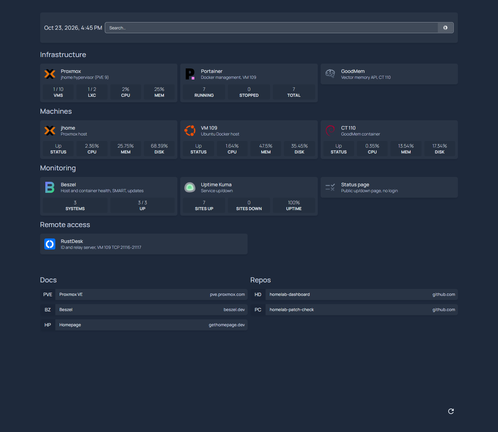

# Homelab maintenance — October 2026

October was mostly patching and visibility. A CA compromise forced a round of updates on October 21. On October 23 I caught up every host on pending updates, replaced an archived container updater, and finally set up monitoring with alerts and a dashboard that pulls live data from everything. Local IPs have their last number replaced with `X`.

The [README](../README.md) has the current inventory. The [September 22 health check](health-check-2026-09-22.md) is the earlier baseline.

## October 21 — CA compromise response

The eMudhra (emSign) CA had a key compromise, and Node.js, Python and uv all shipped fixes. Across the lab:

- Removed trust for `emSign ECC Root CA - G3` from the system CA stores on the Proxmox host and the guests.
- CT 110: snapshot first, then ca-certificates and OpenSSL updates, Docker 29.6.0 → 29.9.2, GoodMem server v1.0.285 → v1.0.331 and PostgreSQL/pgvector 17.10 → 17.11.
- VM 109: snapshot first, Portainer 2.45.1 → 2.45.2, and every stack pulled and redeployed.
- A small read-only script now reports OK / WAIT / ACT / FAIL for each fix on every host, so I can tell when a vendor finally ships a patched image.

## October 23 — updates

| Host | What changed |
| :--- | :--- |
| Proxmox host | Removed leftover Proxmox 8 (bookworm) APT entries and a duplicate security list, so apt now runs without warnings on trixie sources only. Installed the pending updates. Removed an old 6.17.2 kernel, keeping the running kernel plus two fallbacks |
| VM 109 | Installed pending updates (Ubuntu's phased rollout holds back systemd 259.9 and containerd for now). Portainer 2.45.2 → 2.45.3. Homepage 2.6.0 → 2.7.0 and Uptime Kuma 2.5.6 → 2.5.7, both rebuilt on patched Node. Installed `qemu-guest-agent`, so snapshots now freeze the filesystem. Grew the root volume from 14.5 GB to the full 29 GB disk while running. Cleared about 2.3 GB of old rollback images |
| CT 110 | Snapshot, then all 88 pending updates (33 of them security), then a reboot so every service picked up the new libc and systemd. GoodMem was back in 26 seconds |
| Workstation and Mint laptop | Routine updates. The Mint laptop now applies updates automatically every day |

The old `containrrr/watchtower` project was archived in December 2025, and it only worked on Docker 29 through an API-version override. I swapped it for the maintained fork (`nickfedor/watchtower`) with the same flags. It negotiates the Docker API on its own.

Every update had a snapshot or backup taken first. I removed those once the services checked out.

## Monitoring and alerting

Before this I had Uptime Kuma installed but not configured, and nothing watching the hardware. Now:

| Tool | Runs on | Watches |
| :--- | :--- | :--- |
| Beszel 0.21.1 | Hub on VM 109; agents on the Proxmox host, VM 109 and CT 110 | CPU, memory, disk, temperature, container stats, drive SMART health, pending package updates (security ones flagged) |
| Uptime Kuma 2.5.7 | VM 109 | Proxmox web UI, GoodMem, Portainer, Beszel, both RustDesk ports and my portfolio site, including its TLS certificate expiry |

Both send alerts to a private Discord channel. Beszel alerts when a machine is down for two minutes, CPU or memory stays above 90%, a disk passes 85%, a service fails, a container turns unhealthy, the laptop runs hot, or a drive's SMART state gets worse. Kuma alerts after two failed checks in a row, and again on recovery. Kuma also publishes a read-only status page on the LAN.

Beszel found 87 pending updates on CT 110 within minutes of being installed. That's the main reason I want it.

## Dashboard

Homepage 2.7.0 is back as the single landing page, configured this time. I compared it against Homarr, Dashy, Glance, Homer, Heimdall and the Proxmox-specific tools (ProxMenux, Pulse, PegaProx, ProxCenter). Homepage was the only one with live panels for all four tools I run, plus a large user base, frequent releases and a patched runtime.

*Live Proxmox, Portainer, Beszel and Uptime Kuma data on one page.*

The panels use dedicated credentials, not my admin logins:

- Proxmox: a privilege-separated API token on a separate user with only the `PVEAuditor` role. It reads fine, and a test write came back 403.
- Portainer: an access token named for the dashboard.
- Beszel: a separate superuser with a random password, because Homepage's Beszel panel requires a superuser.

None of these is in the dashboard config. Homepage reads them from root-only files mounted read-only into the container. The config itself lives in its own repo and deploys with a script.

## Storage finding

While planning backups I found a third drive: an NVMe SSD left over from Windows. Proxmox never saw it because the SATA controller runs in Intel RST RAID mode, and the kernel log says so: "Found 1 remapped NVMe devices. Switch your BIOS from RAID to AHCI mode to use them."

The plan:
1. Switch the BIOS to AHCI.
2. Wipe the NVMe and make it the VM/CT store.
3. Turn the 1 TB HDD into the scheduled-backup drive.

There are still no scheduled backups, so that's next. The boot SSD's SMART warnings haven't changed since September (24 offline-uncorrectable sectors), and Beszel will now alert if they get worse.

## Not checked

- Portainer actions and the Kuma UI beyond the monitors themselves.
- Phased Ubuntu updates on VM 109, which arrive on their own schedule.
- The GoodMem image still trusts the compromised root inside its Java trust store. That's waiting on an upstream image.
