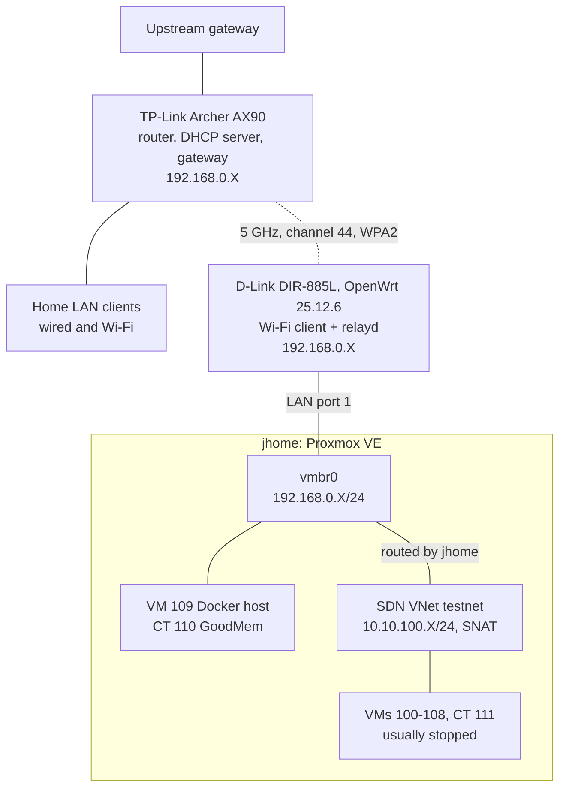

# Lab topology

This is how the lab connects to the rest of my home network as of November 11, 2026. The lab has no cable to the home router. A D-Link DIR-885L running OpenWrt joins the router's Wi-Fi as a client and relays its wired ports onto the home LAN, so the lab hosts sit on the same subnet as everything else in the house. The [DIR-885L project](../projects/2026-11-dir885l-wireless-bridge/README.md) covers how I set that up and what it measured.

Local IPs keep the first three octets and swap the last one for `X`.

## Diagram

The dotted line is the only wireless hop. The Netgear extender that did this job before is not in the diagram: I retired it on November 11, after the bridge passed its soak test.

## Physical layer

| Device | Role | Connection |
| :--- | :--- | :--- |
| TP-Link Archer AX90 v1.0 | Home router: routing, the only DHCP server, the gateway for every host | Its own WAN side sits behind another gateway upstream |
| D-Link DIR-885L (hardware A1) | Wi-Fi client bridge for the lab | 5 GHz client of the router's channel-44 radio; four gigabit LAN ports in one bridge, only port 1 in use |
| `jhome` (Alienware 15 R3) | Proxmox host | DIR-885L LAN port 1, linked at 1000 Mb/s full duplex. It was on the switch until the night of the cutover, then on LAN port 2 until 19:30 on November 11 |
| Netgear 24-port switch | Former lab switch | Unplugged from the DIR-885L on November 11. The lab has too few wired devices to need it, and nothing was behind it |
| Netgear WN2000RPTv2 | Old 2.4 GHz extender that did the bridge's job until November 11 | Retired and unplugged on the evening of November 11, after the soak |

While it was still the rollback, the extender and the DIR-885L could never both be cabled to the lab. Each one answers for the whole lab under its own MAC, and two of these proxy-ARP bridges on one segment would both answer for the same addresses.

## Wi-Fi

The AX90 broadcasts one main SSID on all three of its bands with Smart Connect on, which lets the router steer clients between bands. There is no separate homelab SSID. The 5 GHz channels are set to automatic.

| Radio | Channel on November 10 | Used by the lab |
| :--- | :--- | :--- |
| 2.4 GHz | 7 | No. The DIR-885L's 2.4 GHz radio is off, but I tested it on the bench as a fallback |
| 5 GHz-1 | 44, 80 MHz | Yes. The DIR-885L is locked to this radio |
| 5 GHz-2 | 157, 80 MHz | No. It never showed up in the DIR-885L's scans, which find nothing on channels 149 and up |

Because of that lock, a channel change on the router's 5 GHz-1 radio or a new router means editing the bridge's config.

## Addressing

| Network | Subnet | Gateway | Addresses come from |
| :--- | :--- | :--- | :--- |
| Home LAN, including the lab hosts on `vmbr0` | `192.168.0.X/24` | the AX90 | The AX90's DHCP pool, which covers almost the whole subnet. jhome, VM 109 and CT 110 have reservations. The DIR-885L's own static address is the one host address outside the pool |
| Lab SDN `testnet` | `10.10.100.X/24` | jhome | Proxmox IPAM and DHCP, with source NAT |
| DIR-885L management | `192.168.2.X/24` | none | Static. The bridge's web UI listens only on this address, and I reach it through an SSH tunnel |

The home LAN has no global IPv6, only link-local addresses.

## How the bridge behaves

`relayd` is a pseudo-bridge, not a real layer-2 bridge. That has a few visible effects:

- From the home LAN, every lab host shows up at the DIR-885L's 5 GHz MAC. From the lab side, home hosts show up at the bridge's MAC as well. The old extender behaved the same way.
- It relays IPv4 only. IPv6 link-local traffic no longer crosses between the lab and the home LAN.
- Multicast such as mDNS isn't relayed.
- DHCP does cross it. VM 109 took a new lease from the home router through the bridge ten minutes after the cutover.
- The bridge's own `br-lan` interface gets a new random MAC on every boot, so lab hosts see their neighbour change after each bridge reboot.

I'll give `br-lan` a fixed MAC at the bridge's next reboot. Until then the random MAC stays.

## Monitoring of the path

Uptime Kuma runs inside the lab, so it sees the uplink from the lab side. One monitor pings the home router through the bridge, and another checks that the bridge's SSH port answers. The ping goes to the router rather than to the bridge because the bridge answers its own address locally even when its Wi-Fi link is down.
